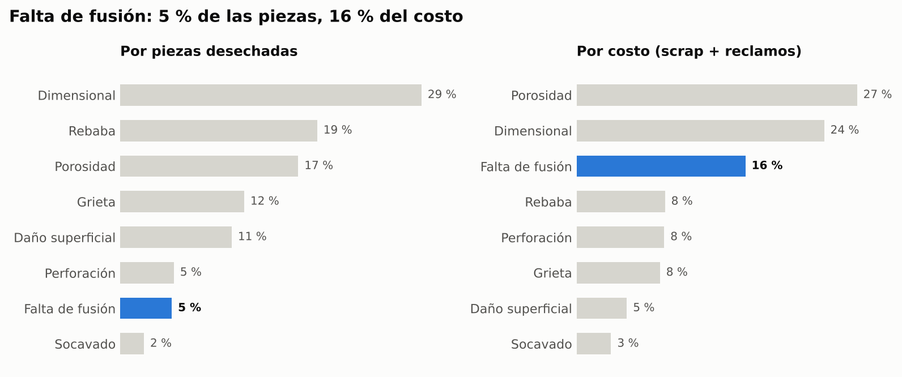
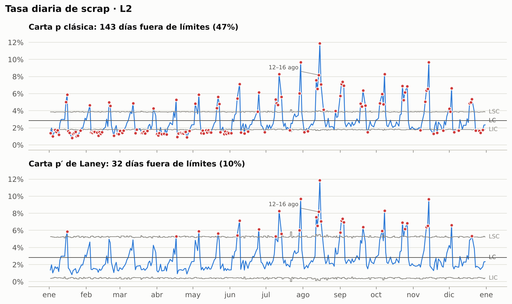
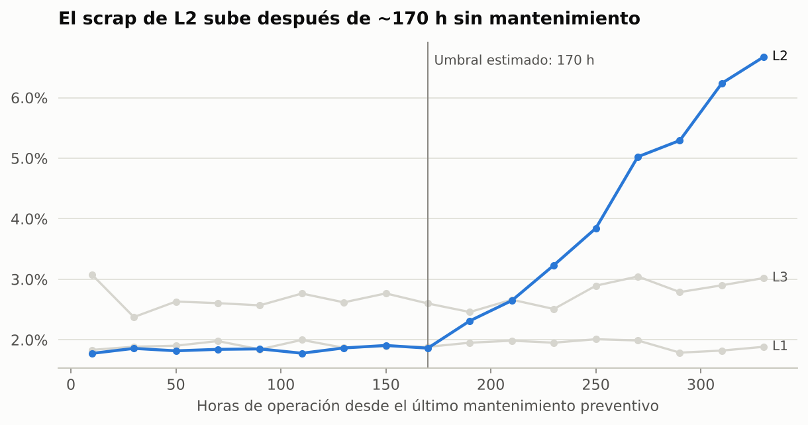
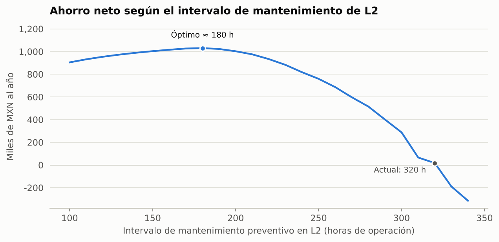
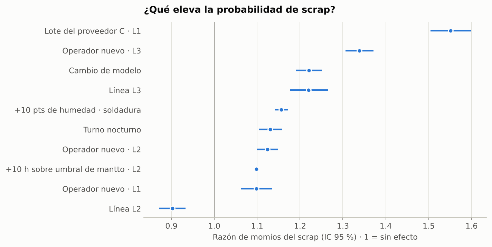
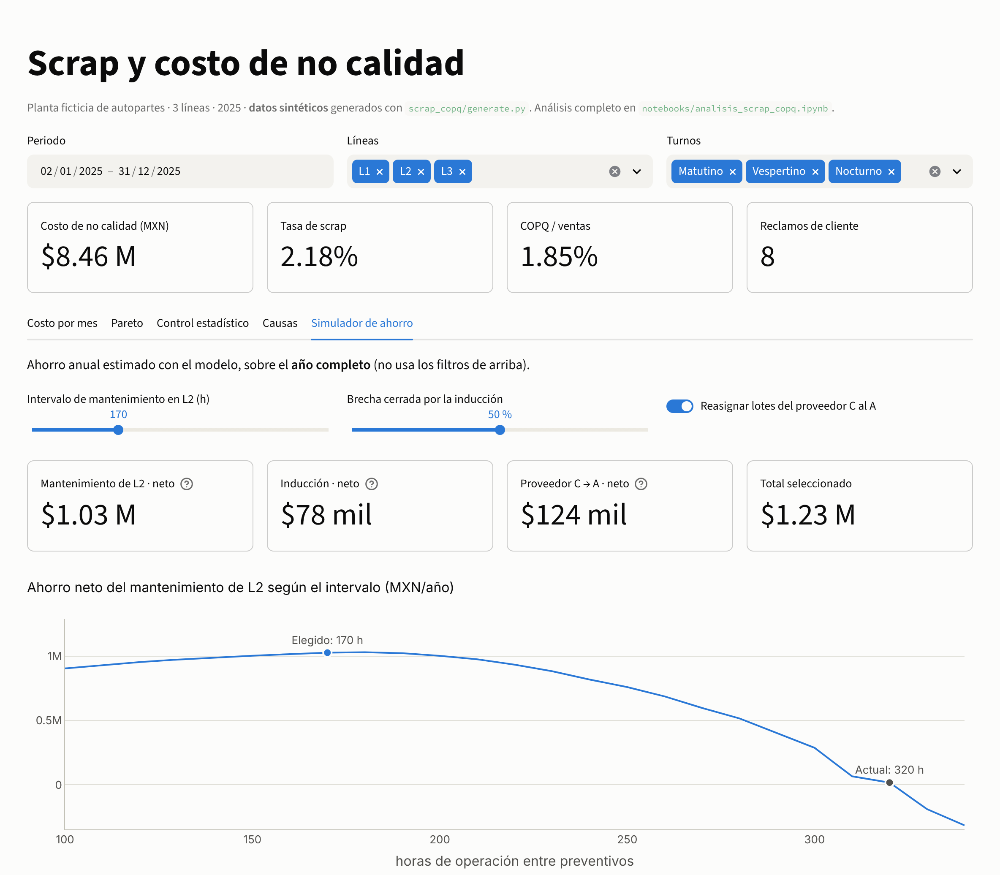

# Scrap and cost-of-poor-quality (COPQ) analytics

*English · [Español](README.es.md)*

**How to find the levers that reduce scrap in an auto-parts plant, put a peso value on them and validate them with statistics.**

Python (pandas, statsmodels) · SQL (PostgreSQL) · statistical process control · binomial GLM · Streamlit

> **Synthetic data.** The plant, its lines and its figures are fictitious. The data are generated by `scrap_copq/generate.py` (fixed seed) and mimic real manufacturing problems: wear between maintenance stops, staff turnover, supplier batches, humidity and a fixture failure.

## Executive summary

**Poor quality cost MXN 8.46 million in 2025 (1.85 % of sales). Three levers cut MXN 1.23 million a year (14.5 % of COPQ), and more than 80 % of that saving comes from one of them: adjusting preventive maintenance on the robotic welding line.**

| Finding | Evidence |
|---|---|
| Wear between maintenance stops on L2 is the largest leak | L2 generates 49 % of scrap cost. Its rate stays at ~1.9 % up to ~170 h after preventive maintenance and reaches 6 % at 310 h; today the interval is 320 h |
| Volume is misleading | *Lack of fusion* is 5 % of scrapped parts but 16 % of the cost, and caused 6 of the 8 customer claims |
| The night-shift problem is turnover | All 10 hires of the year started on nights. Each new operator in manual welding multiplies the odds of scrap by 1.34 |
| The cheap supplier is not cheap | Supplier C delivers 15 % of L1's material but causes 42 % of the cracks; its 2 % discount is lost to scrap and claims |

| Lever | Net annual saving (median) | P10–P90 interval |
|---|---|---|
| Preventive maintenance on L2 every 170–180 h | **MXN 1.03 M** | 1.00 – 1.06 M |
| Move supplier C's batches to supplier A | MXN 0.12 M | 0.12 – 0.13 M |
| Competency-based onboarding for new operators | MXN 0.08 M | 0.06 – 0.09 M |



## Method

```
MES (raw) → cleaning and validation → COPQ and Pareto → p / p′ charts → exploration → binomial GLM → savings simulation
```

1. **Cleaning** (`scrap_copq/clean.py`). Normalises shifts, removes duplicates and excludes impossible runs (more scrap than production, or scrap that does not match the defect breakdown). Missing humidity is imputed with the same shift's reading on another line. Every correction is logged in `data/processed/reporte_calidad_datos.json`.
2. **Cost of poor quality.** Scrap (material plus conversion), rework and customer claims (sorting, urgent freight and penalties).
3. **Double Pareto.** By parts and by cost, with claims attributed to their defect.
4. **Statistical control.** The classic p chart flags 47 % of L2's days as out of control: with thousands of parts per day, any real variation triggers it. **Laney's p′ chart** corrects that overdispersion and leaves 32 days. All of them occur more than 170 h after maintenance, and the defect signature separates two causes: wear (porosity) and a fixture failure (dimensional).
5. **Explanatory model.** Logistic regression on proportions (binomial GLM weighted by parts) with a quasi-binomial scale for overdispersion (χ²/df = 1.78). The maintenance threshold is estimated by minimum deviance. Out of sample (trained on Jan–Sep, evaluated on Oct–Dec), the mean absolute error falls from 1.18 to 0.65 percentage points against the per-line average.
6. **Savings simulation.** The model predicts scrap with and without each lever, values the difference at cost and subtracts the cost of implementing it. Uncertainty is propagated with 2,000 simulations of the coefficients.

<p>
  
  
</p>
<p>
  
  
</p>

The full analysis, with an explanation of each step, is in [`notebooks/analisis_scrap_copq.ipynb`](notebooks/analisis_scrap_copq.ipynb) (Spanish).

## Interactive dashboard

`streamlit_app.py` has period, line and shift filters and five tabs:
- **Cost by month:** monthly COPQ by component.
- **Pareto:** by cost or by parts.
- **Statistical control:** p and p′ charts by line.
- **Causes:** factors that raise scrap.
- **Savings simulator:** move the maintenance interval and the onboarding effectiveness and see the saving.



## How to run it

```bash
python -m venv .venv
.venv\Scripts\activate            # Windows · macOS/Linux: source .venv/bin/activate
pip install -r requirements-dev.txt

python -m scrap_copq.generate      # optional: regenerate the synthetic data
python -m scrap_copq.clean         # cleaning and validation
pytest                             # 17 tests: metrics, cleaning, model and SQL
streamlit run streamlit_app.py     # dashboard
jupyter lab notebooks/analisis_scrap_copq.ipynb
```

**SQL on PostgreSQL.** A schema with integrity constraints, loading of the clean CSVs and three queries: monthly COPQ with a CTE, Pareto with window functions, and Laney's p′ chart with `LAG`.

```bash
createdb planta
psql -d planta -f sql/01_esquema.sql -f sql/02_carga.sql
psql -d planta -f sql/05_carta_p_laney.sql
```

The tests compare each query's result with Python's. In the repository they run on DuckDB so no server is needed; they were also verified on PostgreSQL 16.

## Structure

```
├── scrap_copq/
│   ├── config.py      # plant catalogue and cost assumptions
│   ├── generate.py    # synthetic data with seeded patterns
│   ├── clean.py       # cleaning and validation
│   ├── metrics.py     # COPQ, Pareto, p and p′ charts, Western Electric rules
│   ├── model.py       # binomial GLM, threshold, validation and savings simulation
│   └── plots.py       # notebook and README figures
├── sql/               # schema, load and queries for PostgreSQL
├── notebooks/         # narrated analysis
├── data/raw/          # "dirty" MES export
├── data/processed/    # clean data
├── reports/figures/
├── tests/
└── streamlit_app.py
```

## Data

`produccion_turnos.csv`: one row per line, shift and day (2,751 clean runs in 2025). Column names are in Spanish, as in the plant's MES.

| Column | Description |
|---|---|
| `piezas_producidas`, `piezas_scrap`, `piezas_retrabajo` | Parts produced, scrapped and reworked |
| `horas_desde_mantto` | Operating hours since the line's last preventive maintenance |
| `operadores_nuevos` | Crew operators with less than 6 months' seniority (0–4) |
| `proveedor_material` | Supplier of the sheet or wire batch (A, B or C) |
| `humedad_rel_pct` | Ambient relative humidity |
| `cambio_modelo` | 1 if the run started with a part-number changeover |
| `paro_min` | Minutes of unplanned downtime |

Also: `scrap_por_defecto.csv` (scrap by defect), `reclamos_cliente.csv` (customer claims), `mantenimientos.csv` (maintenance), `altas_operadores.csv` (operator hires) and `catalogo_productos.csv` (costs and prices per part).

## Assumptions and limitations

- **Synthetic data:** the effects were seeded to demonstrate the method. In a real plant each cause is confirmed on the floor, for example with an Ishikawa diagram or 5 whys per finding.
- **Observational model:** the saving assumes that the estimated effects are causal. A pilot with a p′ chart before and after is the definitive test.
- **Costs:** the lever costs (`scrap_copq/config.py`) are assumptions to be replaced with plant data: MXN 4,500 per extra preventive stop, MXN 15,000 per trained operator and a 2 % discount from supplier C.

## License

Code under [MIT](LICENSE).

---

**Jesús R. L. González** · Data Analyst and Data Scientist · Manufacturing operations and quality · [LinkedIn](https://www.linkedin.com/in/jesus-r-l-gonzalez)
